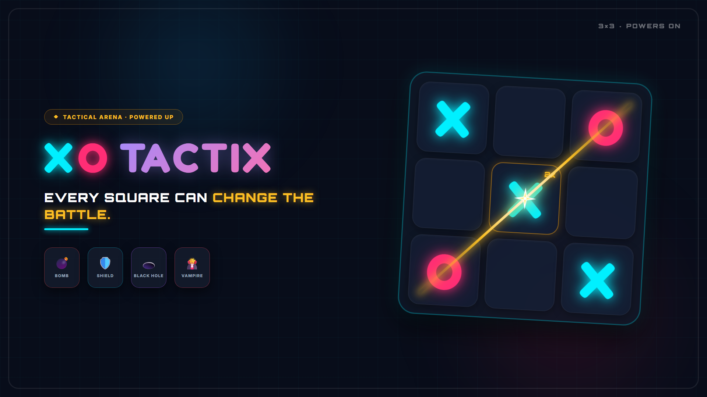

# XO Tactix

<p align="center">
  
</p>

<p align="center">
  <strong>Klasik Tic-Tac-Toe mantığını stratejik özel güçler, Web Worker tabanlı Minimax yapay zekâsı ve ASP.NET Core SignalR gerçek zamanlı oda altyapısıyla birleştiren taktiksel web oyunu.</strong>
</p>

<p align="center">
  <a href="https://rabiaunllu.github.io/react-tic-tac-toe/"></a>
  
  
  
  
  
  
</p>

---

## 🎮 Canlı Demo

* 🌐 **Tarayıcıda Oyna:** [https://rabiaunllu.github.io/react-tic-tac-toe/](https://rabiaunllu.github.io/react-tic-tac-toe/)
* 💡 *Not: Bot (PvC), Lokal 2P, 30 Bölümlük Bulmaca Seferi ve Günün Görevi tarayıcı üzerinde tamamen istemci tarafında (Client-side) çalışır. Çevrim içi oda (SignalR) modu için bulut sunucusu maliyet tasarrufu nedeniyle durdurulmuştur; yerelde çalıştırma adımları aşağıda belirtilmiştir.*

---

## 🏛️ Mimari ve Mühendislik Yaklaşımı

Bu proje, basit bir tutorial uygulamasının ötesine geçerek performans, durum senkronizasyonu ve modern web mühendisliği pratiklerini deneyimlemek üzere tasarlanmıştır:

### 1. Web Worker ile UI Thread İzolasyonu
* Minimax ve Alpha-Beta budama algoritmaları derin arama yaparken yoğun CPU tüketir.
* Ana JavaScript iş parçacığının (UI Thread) kilitlenmesini ve ekran donmalarını önlemek için bot karar mekanizması bağımsız bir **Web Worker (`aiWorker.js`)** üzerinde asenkron olarak koşturulur.
* Render döngüsü 60 FPS akıcılığını korur, animasyonlar ve kullanıcı etkileşimleri kesintiye uğramaz.

### 2. Bitwise Zobrist Hashing ile Sıfır GC Yükü
* Oyun tahtası ve güç durumlarının önbelleklenmesinde satranç motorları (Stockfish) standartlarında **Bitwise Zobrist Hashing** kullanılmıştır.
* Her kare, kalkan, kilit ve tur durumu 32-bit XOR (`^`) işlemleriyle tek bir tamsayıya indirgenir.
* Bellekte string kopyalama ve Garbage Collection (GC) yükü $O(1)$ mikrosaniye seviyesine çekilmiştir.

### 3. ASP.NET Core & SignalR ile Gerçek Zamanlı İletişim
* Çok oyunculu modda 6 haneli oda kodu ile katılım sağlanır.
* Backend tarafında **.NET 8, ASP.NET Core ve SignalR** kullanılarak düşük gecikmeli, çift yönlü WebSocket iletişimi kurulmuştur.
* Bağlantı dalgalanmalarına karşı **Hibrit Senkronizasyon (SignalR + Otomatik Polling Fallback)** mimarisi uygulanmıştır.

### 4. Bilişsel Yük Azaltma ve WCAG AAA Erişilebilirlik
* Oyun içi HUD ve tahta tasarımı, mobil ekranlarda dikey/yatay taşma yapmayacak şekilde (zero-scroll viewport) kurgulanmıştır.
* Renk paleti ve yazı kontrastları **WCAG AAA** erişilebilirlik standartlarını karşılamaktadır.

---

## 🎯 Oyun Modları

| Mod | Açıklama | Altyapı |
| :--- | :--- | :--- |
| **Hızlı Oyna** | Tek tıkla dengeli arena maçına girer. | Web Worker Bot |
| **Bota Karşı (PvC)** | 4 zorluk seviyesi (Kolay, Orta, Zor, Uzman). | Alpha-Beta Minimax |
| **Yan Yana (Lokal 2P)** | Aynı cihazda sırayla hamle yaparak oynanır. | React State |
| **Bulmaca Seferi (Campaign)** | 30 farklı seviye, özel taktiksel kısıtlamalar. | İstemci Durum Yönetimi |
| **Günün Görevi (Daily)** | Her 24 saatte yenilenen görevler ve seri (streak) takibi. | LocalStorage Persistence |
| **Çevrim İçi Oda (Online)** | 6 haneli kodla arkadaşla gerçek zamanlı mücadele. | ASP.NET Core SignalR |

---

## ⚡ Özel Güçler (Arena Modu)

Klasik 3x3, 4x4 ve 5x5 tahtalarda 2x ve 3x puan çarpanlarının yanı sıra 5 taktiksel güç bulunur:

| Güç | İkon | Mekanik | Sıra Etkisi |
| :--- | :---: | :--- | :--- |
| **Bomba** | 💣 | Rakibin korumasız taşını siler ve kareyi 1 tur kilitler. | Sıra rakibe geçer |
| **Kalkan** | 🛡️ | Kendi taşını bombaya karşı kalıcı korumaya alır. | Sıra oyuncuda kalır |
| **Kara Delik** | 🕳️ | Boş bir kareye gizli tuzak kurar; rakip basarsa taşı silinir. | Sıra oyuncuda kalır |
| **Dondur** | ❄️ | Boş bir kareyi 1 tur dondurarak taş konulmasını engeller. | Sıra oyuncuda kalır |
| **Vampir** | 🧛 | Rakibin tahtadaki puan çarpanını (2x/3x) çalıp kendi taşına bağlar. | Sıra oyuncuda kalır |

---

## 🛠️ Kullanılan Teknolojiler

* **Frontend:** React 19, Vite, Modern CSS (Responsive Grid & Flexbox, GPU Hızlandırmalı Keyframe Animasyonları)
* **Algoritmalar:** Minimax, Alpha-Beta Pruning, Bitwise Zobrist Hash, Heuristic Matrix
* **Thread Yönetimi:** Web Workers API (`aiWorker.js`)
* **Backend:** C# / .NET 8, ASP.NET Core Web API
* **Gerçek Zamanlı İletişim:** SignalR (WebSockets & Long Polling Fallback)
* **Yerelleştirme:** Türkçe ve İngilizce dil desteği (i18n)

---

## 🚀 Projeyi Yerel Ortamda Çalıştırma

### 1. Frontend Kurulumu
```bash
git clone https://github.com/rabiaunllu/react-tic-tac-toe.git
cd react-tic-tac-toe

# Bağımlılıkları yükle
npm install

# Geliştirme sunucusunu başlat
npm run dev
```
Uygulama tarayıcınızda `http://localhost:5173` adresinde açılacaktır.

### 2. Backend (Online Oda Modu İçin)
Gerçek zamanlı çevrim içi oda altyapısını yerel ortamda çalıştırmak için:
```bash
# Backend dizinine geç
cd server/XoArena.Api

# .NET 8 API ve SignalR hub'ı ayağa kaldır
dotnet run
```
API ve WebSocket Hub `http://localhost:5150` portunda yayına başlar. Frontend otomatik olarak bu yerel sunucuya bağlanır.

---

## 📂 Proje Dizin Yapısı

```text
├── docs/                   # Mimari, yapay zekâ analizleri ve dokümantasyon
│   ├── AI_ARCHITECTURE.md  # Zobrist hash ve Minimax karar ağacı detayları
│   └── images/             # README görsel ve afişleri
├── server/
│   └── XoArena.Api/        # .NET 8 ASP.NET Core & SignalR backend
│       ├── Hubs/           # RoomsHub (WebSocket senkronizasyonu)
│       ├── Models/         # Oda, tahta ve oyuncu veri modelleri
│       └── Services/       # Oda yaşam döngüsü ve bellek içi depolama
├── src/
│   ├── api/                # SignalR bağlantısı (useGameSync) ve REST istemcisi
│   ├── components/         # React arayüz bileşenleri (Board, GameSetup, OnlineGame...)
│   ├── game/               # Web Worker (aiWorker.js), Minimax motoru, ses yöneticisi
│   └── i18n/               # TR/EN dil destek paketleri
└── vite.config.js          # Vite derleme ve CSP yapılandırması
```

---

## 📄 Lisans

Bu proje [MIT Lisansı](LICENSE) kapsamında geliştirilmiştir.
