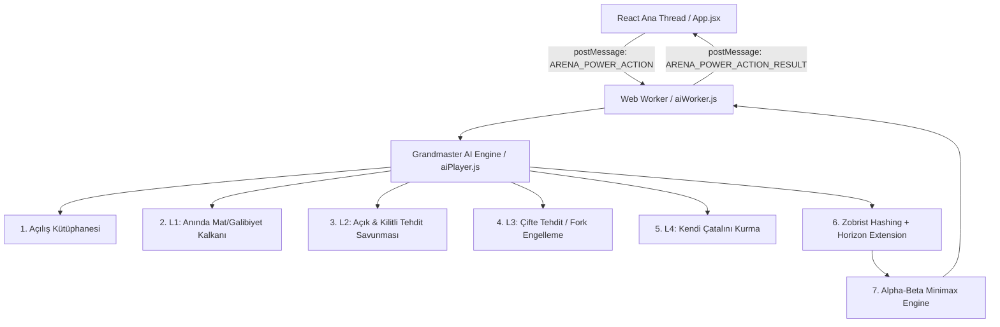

# XO Arena — Yapay Zeka (AI) Mimari ve Çalışma Mantığı

Bu doküman, **XO Arena** projesinde yer alan yapay zeka motorunun mimarisini, karar ağacını, **Zobrist Hashing** önbellek yapısını, **Dinamik Kaynak Yönetimini (Phase Multipliers)**, **Normalize Heuristic Matrisini** ve taktiksel kalkanlarını detaylandırmaktadır.

---

## 🏛️ 1. Genel Mimari ve Web Worker İzolasyonu

Yapay zeka hesaplamaları ana UI (React render) iş parçacığını (thread) kilitlememesi için **Web Worker** üzerinde asenkron olarak çalışır.

* **Dosya:** [`src/game/aiWorker.js`](file:///d:/PROJECTS/react-tic-tac-toe/src/game/aiWorker.js)
* **Avantajı:** Arama ağacındaki derin Alpha-Beta simülasyonları sırasında mobil ve masaüstü tarayıcılarda 60 FPS akıcılık korunur, UI asla donmaz.
* **Tepki Süresi:** Açılış ve taktiksel kalkanlarda **< 1 ms**, derin Alpha-Beta aramalarında ise **< 5-10 ms** sürede sonuç üretilir.

---

## ⚡ 2. Bitwise Zobrist Hashing (Sıfır RAM & Sıfır GC Yükü)

Önceki string tabanlı (`${squares}|${turn}...`) önbellek yapısı yerine, satranç motoru (Stockfish) standartlarında **Bitwise Zobrist Hashing** entegre edilmiştir.

* **Nasıl Çalışır?** Her hücrenin durumu (Boş, X, O), kalkanlar, çarpanlar, kilitler ve tur sırası rastgele 32-bit tamsayılarla XOR (`^`) işlemine sokulur.
* **Sonuç:** Tek bir unsigned 32-bit tamsayı (`hash >>> 0`) üretilir. 
* **Faydası:** String üretimi ve Garbage Collection yükü sıfırlanır, önbellek okuma süresi **$O(1)$ mikrosaniye** seviyesine iner.

---

## 🃏 3. Dinamik Kaynak Çarpanı (Phase Multipliers)

Botun güçlerini oyunun başında erkenden harcamasını (Resource Exhaustion) önlemek için oyun evrelerine göre dinamik çarpan kuralı uygulanır:

1. **Açılış Evresi ($\le 2$ Taş):**
   * Güç kullanım çarpanı: **$0.25\times$**
   * Bot, acil bir mat/tehdit durumu yoksa açılışta elindeki Kalkan/Dondur/Vampir güçlerini asla harcamaz; güçleri oyun sonuna saklar.
2. **Orta Oyun ($3 - 5$ Taş):**
   * Güç kullanım çarpanı: **$1.0\times$** (Standart dengeli taktikler).
3. **Oyun Sonu / Endgame ($\ge 6$ Taş):**
   * Güç kullanım çarpanı: **$2.0\times$** (Güçlerin etkisi katlanarak ölümcül hamlelerde devreye sokulur).

---

## 🧮 4. Normalize Edilmiş Heuristic Matrisi

Puan uçurumu kapatılarak tüm taktiksel ve konumsal faktörler birbiriyle dengeli tartılır:

| Durum / Tehdit Türü | Puan (Score) | Açıklama |
|---|:---:|---|
| **Doğrudan Galibiyet (AI Win)** | `+100,000 - ply` | En kısa yoldan mat etme önceliği |
| **Doğrudan Mağlubiyet (Human Win)** | `-100,000 + ply` | Mat olmaktan kesin kaçış |
| **AI Açık Tehdit (1 Boşluk)** | `+5,000` | Botun kazanma tehdidi |
| **Rakip Açık Tehdit (1 Boşluk)** | `-6,000` | Rakibin kazanma tehdidi cezası |
| **AI Kilitli Tehdit (Lav Arkası)** | `+3,500` | Kilit açılınca kazanacak seri |
| **Rakip Kilitli Tehdit (Lav Arkası)** | `-4,500` | Rakibin kilit açılınca kazanacağı seri |
| **AI Çifte Tehdit (Fork)** | `+7,000` | Savunulamaz 2'li galibiyet hattı |
| **Rakip Çifte Tehdit (Fork)** | `-8,500` | Rakibin çifte tehdit kurma cezası |
| **Çatal Merkezi (Fork Hubs)** | $\pm 1,200 \times (N - 1)$ | Birden fazla açık hattı bağlayan köşe taşları |
| **Merkezde Kalkanlı Taş** | `+600` / `-600` | Merkezin kalkanla kilitlenmesi |
| **Köşe/Kenarda Kalkanlı Taş** | `+300` / `-300` | Korunan taş bonusu |
| **Çarpanlı Kare Hakimiyeti** | $+150 \times \text{çarpan}$ | 2x ve 3x çarpanlı kare puanı |
| **Güç Rezervi Saklama Bonusu** | `+200` / güç | Elindeki harcanmamış güçleri saklama ödülü |
| **Kara Delik Kötümser Riski** | `-150` | Rakibin elinde tuzak varken tehlikeli kare cezası |

---

## 🔭 5. Ufuk Çizgisi Genişletmesi (Horizon Extension & Quiescence)

Lav çatlakları (bomba kilitleri) ve dondurmalar 1 tur sonra çözülür. 
* Minimax arama derinliğinin sınırına (depth = 0) ulaştığında tahtada aktif kilit veya dondurma varsa, arama derinliği **$+1$ ply otomatik genişletilir.**
* Böylece yapay zeka kilidin açılacağı anı "ufkun arkasında kaldı" diye unutmaz; açılış anındaki ölümcül tehditleri önceden görür.

---

## 🛡️ 6. 4 Kademeli Sert Taktiksel Kalkanlar (Hard Guards)

1. **Açılış Kütüphanesi (Opening Book — 0 ms):** İlk hamlede merkez veya en değerli köşe.
2. **Hard Guard L1 (Immediate Win):** Tek hamlede bitirme varsa 0ms infaz.
3. **Hard Guard L2 (Threat Defense):** Açık tehditleri zorunlu bloke eder; kilitli tehditlerde ise **zorunlu bomba savunması** uygular.
4. **Hard Guard L3 (Anti-Fork):** Rakibin çatal kurmasına izin vermez.
5. **Hard Guard L4 (AI Fork):** Kendi çatalını kurar.

---

## 🎯 7. Nihai Güvenceler ve Kapanış Özeti

| Güvence / Savunma | Algoritmik Çözüm | Sonuç |
|---|---|---|
| **Çift Tehdit (Fork) Tuzağı** | `getForkSquares` & `getForkHubScore` | Köşe ve kesişim tuzakları henüz kurulmadan imha edilir. |
| **Kilitli Bomba Matı (Horizon Effect)** | `Hard Guard L2` & `Horizon Extension (+1 ply)` | Lav kilidinin arkasındaki tehditler zorunlu bombayla kırılır. |
| **Erken Güç İsrafı (Resource Waste)** | `Phase Multiplier (0.25x - 2.0x)` | Güçler açılışta yakılmaz, oyun sonu için saklanır. |
| **Bellek & CPU Yükü** | `Bitwise Zobrist Hash` & `Web Worker` | 60 FPS akıcı oyun, sıfır GC çöpü, <5ms tepki süresi. |
| **Zorluk Garantisi** | `DGD Bypass (100% Grandmaster Mode)` | Bot ilk saniyeden itibaren tavizsiz en güçlü hamleyi oynar. |

